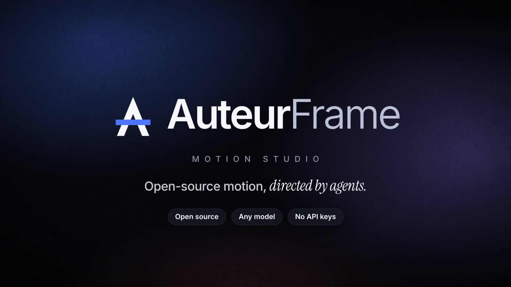

<p align="center"></p>

# AuteurFrame website

The official website of **AuteurFrame**, the open-source motion studio directed by AI agents.

**Live site:** <https://joyghoshs.github.io/Auteur-frameProject/>
**Software:** <https://github.com/joyghoshs/auteurframe>

## What is here

A single static page with no build step and no external requests:

- the one-minute launch film, with English captions and a lighter 720p version for phones;
- how the agent swarm works, a tour of the studio, all 21 templates and films made with AuteurFrame;
- install instructions for Ubuntu, Windows (WSL2), macOS and Docker;
- licensing, contribution steps and an FAQ.

```
index.html              the page
404.html                not-found page
assets/css/site.css     styles
assets/js/site.js       navigation, video player, tabs, copy buttons and reveal animations
assets/media/           launch film (1080p and 720p), poster and captions
assets/img/             studio screenshots, template posters, film stills and the social image
assets/fonts/           Inter, Instrument Serif and JetBrains Mono, served locally (SIL OFL 1.1)
```

## Run it locally

```bash
python3 -m http.server 8080
```

Then open <http://localhost:8080>.

## Publish with GitHub Pages

1. Push this folder to the `main` branch of `joyghoshs/Auteur-frameProject`.
2. Open **Settings → Pages**, choose **Deploy from a branch**, select `main` and `/ (root)`, and save.
3. The site goes live at <https://joyghoshs.github.io/Auteur-frameProject/> within a minute or two.

To use a custom domain later, add it under **Settings → Pages → Custom domain** and update the canonical and social
image URLs at the top of `index.html`.

## Rights

The AuteurFrame software is free software under the GNU AGPL v3; see its
[repository](https://github.com/joyghoshs/auteurframe). The website text, design, launch film, screenshots and images
are © 2026 Abdur Rahman Maheer, all rights reserved. The fonts are licensed under the SIL Open Font License 1.1, included in `assets/fonts/FONTS-LICENSE.txt`.
